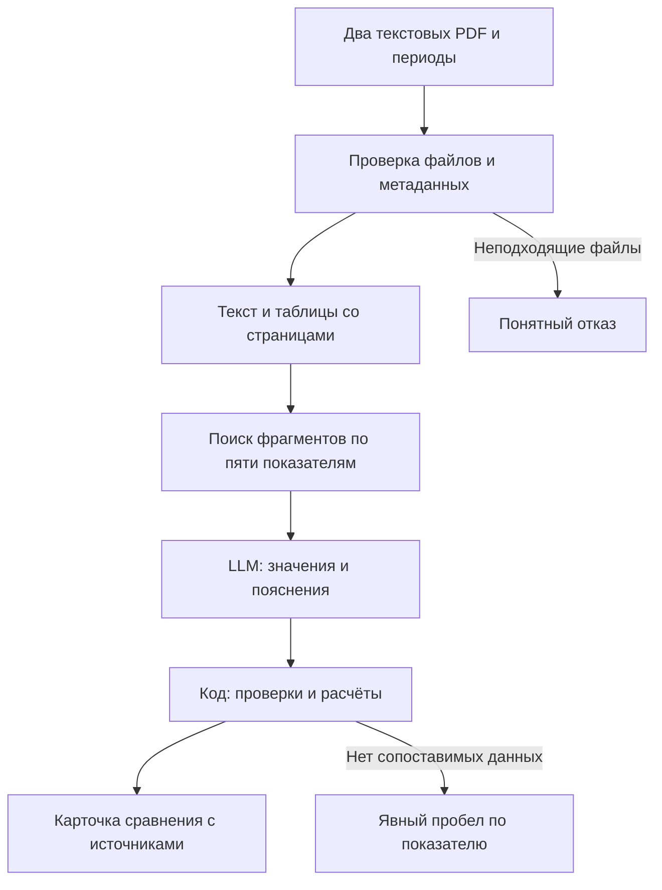

# Архитектура MVP

Статус: проект, компоненты ещё не реализованы. Выбран минимальный контур для проверки гипотезы, без обязательства использовать конкретного модельного провайдера.

## Компоненты

| Компонент | Задача | Проверяемый результат |
| --- | --- | --- |
| Веб-страница | Два файла, периоды, результат | Пользователь понимает ограничения и открывает источник |
| Python / FastAPI | Управление обработкой и сессиями | Валидация входа и изоляция файлов |
| Обработчик PDF | Текст и таблицы | Сохраняется связь фрагмента с физической страницей PDF |
| Поиск | Разделы, ключевые слова и словарь вариантов | В найденных фрагментах присутствуют нужные значения |
| LLM | Структурированное извлечение и краткие пояснения | Значение связано с периодом, единицей и цитируемым фрагментом |
| Проверки и расчёты | Нормализация единиц, структурные ограничения, арифметика | Ошибки и пропуски видимы, деление на ноль исключено |
| Временное хранилище | Только файлы и результаты текущей сессии | Удаление при завершении и по сроку хранения |

Кандидат модели: Qwen3-8B, как указано в задании. Решение о модели и способе размещения принимаем после проверки качества, доступных ресурсов, лицензии, задержки и полной стоимости. Работоспособность этой модели на задаче пока не подтверждена.

## Контракт результата

Для каждого показателя нужны:

- точное определение и состояние: найден / отсутствует / несопоставим;
- исходное текстовое значение, нормализованное число, валюта и масштаб;
- тип периода: интервал или отчётная дата;
- идентификатор файла, физическая страница PDF и фрагмент-основание;
- отдельная отметка о пересмотре сравнительных данных;
- рассчитанное изменение и причина отсутствия процентного изменения;
- пояснения только с фрагментами-основаниями.

Без основания число не должно попадать в итоговую таблицу. Предположение LLM о причине изменения не является фактом: если отчёт показывает только изменение, так и пишем. Расположение фрагмента на странице можно проверить кодом, смысловую корректность нужно оценивать отдельно.

## Альтернативы и выбор

| Подход | Преимущество | Ограничение |
| --- | --- | --- |
| Ручной поиск и таблица | Прозрачность, минимум инфраструктуры | Время пользователя; это обязательная база сравнения |
| Правила под один шаблон | Предсказуемость на стабильном формате | Правила нужно менять при иной структуре отчёта |
| Поиск фрагментов + LLM | Возможность связать разные формулировки | Риск ошибок, стоимость и необходимость проверки |

Третий подход выбран как проверяемая гипотеза. Если он не улучшает полный пользовательский процесс, добавление агентов или векторной базы само по себе не считается решением.

## Граница MVP

Только опубликованные текстовые PDF по МСФО, один эмитент в паре. Сканы, OCR, массовое автоматическое скачивание, постоянная база отчётов и интеграции с брокером отложены. Точные ограничения файлов и страниц определяются тестом извлечения до реализации загрузки.
